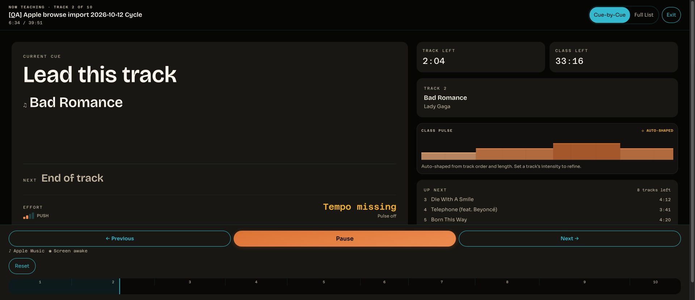

# Apple 5:18 recovery investigation — 2026-10-13

**Result: not reproduced in a controlled visible-browser, fresh-session run.** Steven confirmed
normal audio through the natural Abracadabra → Bad Romance handover and continuation to 6:34,
then silence after the agent's intentional Exit. The original unwitnessed 5:18 cause remains open.
This result does not establish a Ritmo defect, a repair, or general Apple stability acceptance.

## Question and source finding

The earlier run held at Live 5:18 on Bad Romance and showed Playback stopped / Music is paused,
stalled, or its position cannot be verified. Steven was not listening at that moment. The
[earlier evidence](../provider-acceptance-2026-10-13/README.md) separates that event from the brief
waiting panel at an otherwise clean natural handover.

Current source (`runtime.ts`, lines 547–617) shows that the exact later message follows ten seconds
without a transport reading confirming increasing playable position. The separate hung-read path
has a different message. This establishes the detection mechanism, not its initiating cause.
`fail()` (line 723) destroys the active adapter; Apple adapter `destroy()` calls MusicKit.stop().
The old not-playing/position-2 SDK snapshot was collected **after recovery**, so it cannot establish
whether Apple stopped first or Ritmo's teardown produced that state. No guard was weakened.

## Controlled run and provenance

- Local main/source base `26158c4` (#521 merged); application content remains deployed source
  `4fd1ecd`, SPA `assets/index-C1EvvyLa.js`, Worker `73493517-2006-4beb-bf7c-cdb1edf298fd` at 100%
  on the read-only recheck. Relevant source hashes are in `run-resumed/run-metadata.json`.
- Exact retained QA class: `[QA] Apple browse import 2026-10-12 Cycle`, ID
  `75b7af90-141f-4f56-b02b-0bdd2c1c9dfe`. No new production fixture or class-content edit.
- Chrome had closed during the interruption. The resumed run reopened Chrome, used a fresh page
  and MusicKit instance, and checked the existing authorization. Current reduced user-agent reports
  Chrome 155; the original failure's browser version and pre-error focus state were not captured.
  No browser upgrade was performed by this investigation.
- Agent announced and clicked Start; Steven confirmed Abracadabra audible and left playback
  untouched. There was no Pause, seek, Next, Retry or device change performed by the agent.
- Five temporary listeners recorded official SDK state/error events and visibility/focus events.
  They were installed before playback preparation, contained no audio/credentials, and did not
  modify operational callbacks, SDK methods, class data or provider control. All five were removed;
  post-run verification confirms the diagnostic namespace absent.
- There are **243 periodic observations and 18 SDK events**. Median periodic gap 1.02115 s;
  maximum gap 105.104 s during the early first track. SDK listeners remained installed between
  capture chunks. The **5:05–5:40 critical window has 35 observations**, maximum gap 1.0268 s,
  all reporting playing/progress. Periodic sampling was not uninterrupted across the entire run.
- No sampled recovery alert or recorded mediaPlaybackError event. All observations reported
  visible/focused; no visibility/focus-change events were recorded. This does not test background
  throttling, screen lock or interruptions on other devices.
- SDK boundary trace retained Abracadabra's paused endpoint at 223 s, then seeking/ended at zero,
  followed by Bad Romance loading/playing. Ritmo advanced normally. This is a successful instance
  of the boundary behavior, not proof that all event orders or classes succeed.
- Last pre-Exit observation: Live **6:34**, Bad Romance **171 s**, SDK playing. The planned 6:00
  stop overshot by 34 seconds during the chunk/response gap; actual timing is preserved. Exit
  intentionally generated the final paused/seeking/stopped events. Post-Exit SDK: stopped,
  not playing, position 0, no item ID. Steven reported “Normal through 6:34; Exit left silence.”

## Evidence and limits

`summary.json` distinguishes confirmed observations from the unresolved original cause. The
`run-resumed/` folder retains the protocol/source identity, raw whitelisted transport samples,
SDK events, listener installation/removal, owner reports, terminal DOM/JPEG and intentional-Exit
record. The two top-level baseline files are the earlier interrupted preparation; no playback run
was captured in that phase. Images retain their native JPEG format.

Official SDK transport readings are operational evidence, not a substitute for hearing. Provider
audio was not captured, downloaded, cached, decoded, analyzed, mixed or proxied. No credentials,
headers, tokens, SDK configuration or network bodies were collected. No product code changes,
deployment, fixture/branch/worktree cleanup, full-class run, real-device or screen-reader test.

## Recommendation

Keep the original recovery unresolved, with this foreground reproduction recorded as negative.
Before proposing a code fix, compare a controlled background-tab case in the **same browser and
SDK session**, with the owner listening. Prefer event-only recording and before/after samples so
continuous polling does not itself keep the renderer active. Record any visibility gap, SDK pause,
position plateau/regression or media error **before** the recovery teardown. Background is a test
hypothesis, not an established cause. Screen-lock/device-interruption cases require their own
attended scope; no forced seek is equivalent to the original natural run.
