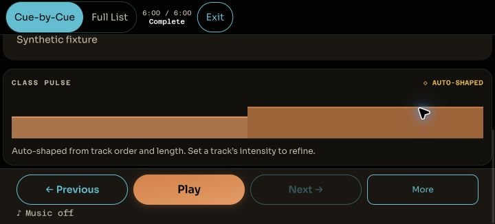
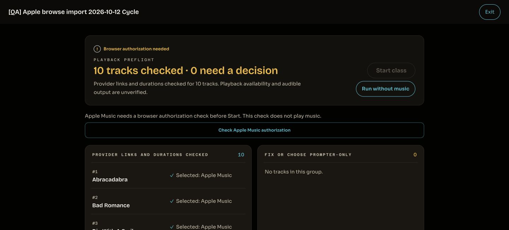

# Builder / Live deployment and completed browser preflight — 2026-10-13

The owner-authorized #518/#519 application batch is deployed from main `4fd1ecd` as Worker
`73493517-2006-4beb-bf7c-cdb1edf298fd` at 100%. The served SPA is `assets/index-C1EvvyLa.js`.
Human audible acceptance remains open. This packet completes the browser checks that were blocked
in the [October 12 preflight](../deployment-preflight-518-519-2026-10-12/README.md).

## Release and infrastructure evidence

- Pre-deploy candidate, local main, origin/main and GitHub main agreed at
  `4fd1ecd2e00967b0c14df295e28ae8fcf068b987`. All 501 source hashes still matched the previously
  completed twelve-step gate. A fresh build reproduced the prepared SPA and its SHA-256
  `9c8ac2825d5c5a2cf17be7b831949e6e60fbac192f1388a5cb9573882a25bb95`.
- Remote D1 reported no migrations to apply. `BETA_ALLOWED_EMAILS` existed by name. No secret
  values were read or changed. The prior Worker `9563d726-bc4d-44f7-834a-d7dbcc388d19` remained
  available as the immediate rollback anchor. No rollback was executed.
- Canonical `pnpm --filter @ritmofit/api run deploy` completed after the web build. The Worker
  serves the production SPA and API; the isolated local config was not used for deployment.
- Independent post-deploy status confirms the new Worker at 100%. Three consecutive cache-busted
  SPA fetches matched the build on the first settle attempt; the served JS SHA-256 agrees.
- Eleven HTTP probes passed: SPA/health, JS/CSS and service worker 200; protected classes,
  explore, teams, provider connections/search and QA-shaped class-tracks paths 401. All six health
  security headers are present. Unauthenticated 401 establishes protection, not individual handler
  mounting. API source is unchanged and the prior 184-test integration suite passed; authenticated
  class/track loading and Live entry/Exit were additionally exercised in the browser.
- Receipts: `predeploy.json`, `deployment.json`, `postdeploy.json`, sanitized CLI logs. Worker
  deployment and SPA/browser asset identities are checked independently.

## Completed local browser preflight

Chrome restarted after manual unlock. Its previous browser session and QA window were gone;
the retained local server/database and synthetic account/class survived. The replacement session
supports DOM inspection. Only the isolated local stack at loopback port 8795 was used here.

`browser-observations.json` contains 75 observations, including a measured 12-surface × 5-width
matrix at exact **1280 / 953 / 680 / 390 / 320 CSS pixels**, height 900. Marketing, login, empty
dashboard, Builder, inspector, Music, Account, connections dialog, create dialog, Live at rest,
Full List and Cue-by-Cue completion were checked. No document horizontal overflow was observed.
An additional synthetic local account established the empty-dashboard case; no production account
or class was created. Local synthetic passwords were not saved to Chrome.

Native Chrome's toolbar directly confirmed **Zoom: 200%**. After resetting emulation, the actual
viewport was 720×325 CSS pixels, DPR 4, visual scale 1. Native zoom checks covered Account,
connections, empty dashboard, Live rest/completion and Builder return. The viewport capability
initially produced half the requested CSS width because the origin retained 200% zoom; these five
exploratory observations remain labeled `live-rest-<requested width>`. Subsequent `*-css-*` cases
set twice the requested dimensions and verify the actual CSS dimensions. Emulated DPR 2 cases are
kept distinct from native zoom. All temporary viewport overrides were reset.

`focus-observations.json` records both dialogs: focus enters the dialog, `#root` has `inert` and
`aria-hidden="true"`, backward/forward Tab wraps, and Escape clears those attributes and returns
focus to the exact Manage / Start empty trigger. Full List and Exit back to Builder passed.
Completion was induced with the End key on a synthetic, prompter-only timeline; it is not a natural
class run or provider playback. The short native viewport permits vertical scrolling; no claim
that every cue and control appears simultaneously is made.

## Authenticated production smoke and PWA update

The new production tab initially loaded the prior cached SPA `index-DyruxT0m.js`. The app's
**Update available → Reload now** prompt switched it to `index-C1EvvyLa.js`. This verifies the
prompted PWA update path; a successful edge fetch alone was not treated as browser alignment.

The exact retained Apple QA class `[QA] Apple browse import 2026-10-12 Cycle` was inspected.
Its ten provider-linked tracks loaded. Prompter-only Live entry, Cue-by-Cue and Full List at 390×844,
Full List and Exit/Builder return at 320×568 passed without horizontal overflow. These are viewport
emulations, not real-device evidence. No provider audio was started during this smoke, and no class
content was edited or fixture deleted. Opening the retained QA class may update its recency.
Unrelated class-chooser content is excluded from the saved DOM records and screenshots.

`production-browser.json` retains the old/new asset observations and scoped QA views. The browser
is left at the named Apple class's settled preflight: ten tracks checked, browser authorization
needed, Start disabled. Steven was asked to perform the authorization check as step 1 of 4; this
does not play music. Human authorization/start/handover/Exit and SoundCloud audible checks remain
open until actual observations arrive. Earlier Apple initial audible start remains historical
evidence; authorization to perform a listening check is not a listening result.

## Publication and retained state

These deployment/browser records update [PR #521](https://github.com/steven-crosby/ritmofit-web/pull/521).
The preceding evidence head `0775e5a` passed full CI and review; the updated head requires renewed
CI/review before any separately authorized squash merge. No product source changes are included.
The current history, planning block and owned release handoff record actual production identity.

The October 12 cleanup receipt remains authoritative: the finished #520 verification branch was
removed locally/remotely; both managed lane archive calls were refused because their worktrees are
pinned/protected. Both lane branches, worktrees and untracked briefs remain. Existing tags,
original classes/source playlists, the two listening QA fixtures and local smoke state
are preserved. Protected worktrees are not removed manually. Human audible acceptance and real
iPhone acceptance remain open; the pre-existing Live view-tab arrow-key issue remains separately
scoped. No provider audio was captured, downloaded, cached, analyzed or proxied.

## Subsequent attended Apple observations

Steven subsequently confirmed browser authorization, audible Abracadabra start with advancing
clock, and a clean natural handover to Bad Romance. He also captured a transient Waiting for music
panel at the boundary; it later cleared. Exit silence and SoundCloud listening remain pending.
[Separate attended evidence](../provider-acceptance-2026-10-13/README.md) preserves his reports and
original screenshot. The authorization-pending state above describes the initial technical handoff.

Subsequent completion: Steven confirmed Apple post-Exit silence and all four SoundCloud listening
checks. A separate later Apple recovery at 5:18 was unwitnessed and remains an open investigation;
no uninterrupted Apple stability pass is claimed. The separate attended record supersedes the
pending-check state above without altering the original technical observations.
