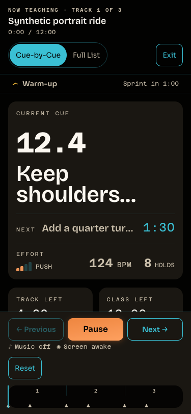
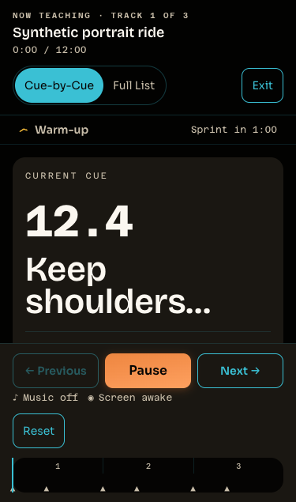

# Live portrait glance: no-work closure — 2026-10-11

Round `r20261010b`, lane 1. Fresh synthetic verification of base `14c8326db9390e09dfb193e97ffa3d4c1fdf89f7`, whose Live presentation source is unchanged by the Builder candidate. All five variants meet the brief's 375×812 criteria: current cue, next cue row, and countdown are visible without scrolling; horizontal overflow is zero. No Live production code was edited.

Claude's reported screenshots were not present in the checkout. This packet captures new evidence rather than claiming to preserve or replay those missing artifacts. It uses the actual `LiveMode`, stylesheet, generated tokens, self-hosted fonts, and synthetic three-track data in installed Chrome with explicit CSS viewport emulation. It chooses **Run without music**, then activates the visible Play control. Provider references are empty and the connection list is mocked locally. No account, music SDK playback, production data, or listener is involved.

## Results

| CSS viewport | Short | Long | Long + count | Long + holds | Long + section/count/holds |
| --- | --- | --- | --- | --- | --- |
| 375×812 | Pass | Pass | Pass | Pass | Pass |
| 375×635 | Pass | Pass | Pass | Pass | **Fail** |
| 320×568 | Pass | Pass | **Fail** | Pass | **Fail** |

Every capture has zero horizontal overflow and zero Live-shell scroll offset. A pass requires all three teaching elements inside the viewport, above the sticky transport, and unobscured at their center. The current cue's computed two-line clamp is checked to reject an unstyled fixture. [Raw results](./results.json), [source/artifact hashes](./sha256.json), and fifteen screenshots retain the observations. No browser page errors occurred.

At 375×812, header/section/transport occupy **42.7–47.3%** of the viewport. Next is truncated in all variants. Long current text is clamped to two lines; this check establishes visible teaching elements, not complete focal-card text. Full guidance and Full List remain the existing paths to complete authored guidance.

At the estimated 375×635 viewport, the section/count/hold variant's Next row and countdown fall behind the transport. At 320×568, count-bearing variants fail. Our fixture does **not** support Claude's broader report that every 320×568 case fails; cue content and fixture differences can change the result. These heights are synthetic CSS viewports, not measurements from an iPhone with Safari toolbars.





## Capture method and limits

The capture waits for font loading and clicks the visible sticky Play button with pointer coordinates. A Playwright locator click scrolled the transport's underlying layout box and hid the cue; that injected scroll was removed from the method. Each retained result records both document and Live-shell offsets. This packet uses headless installed Chrome, reduced-motion preference, and CSS viewport emulation. It does not establish actual browser zoom, real-device usability, provider behavior, audible playback, or natural class completion. No broader responsive regression claim is made because no Live source changed.

Reproduce from the repository root after the documented dependency install:

```bash
pnpm --filter @ritmofit/web tokens
node docs/audits/live-glance-2026-10-11/serve.mjs
# In another terminal, with an available Playwright module and installed Chrome:
node docs/audits/live-glance-2026-10-11/capture.mjs
```

The dedicated default port is 5184; `GLANCE_PORT` changes it for both scripts. `PLAYWRIGHT_MODULE` can name an externally installed Playwright module when the default package is unavailable. The fixture and capture scripts never ship in the SPA.

## Closure and parked decisions

The original 375×812 slice needs no implementation. Next truncation and shorter-height pressure are parked until the attended real-iPhone investigation can measure the actual viewport and teaching needs. Reset and the timeline remain visible; no "More" reorganization was made.

There is a documentation conflict: the owner-approved [OD-02 ledger](../studio-pulse-check-2026-09-13/run-decisions.md) names the next cue as the visual hero, while [layout guidance](../../../ritmofit_design_system/04-layout-and-surfaces.md) names the current cue. No superseding owner decision was verified, and this closure does not choose one. Resolve that wording before a future hierarchy redesign.

The original [closed lane handoff](https://github.com/steven-crosby/ritmofit-web/blob/4412c3c6231e9b8bfa6dad831c6100421c3adc04/ritmofit_dev_plan/handoffs/2026-10-11-r20261010b-live-glance-closed.md) is retained in Git history. Its observations now route through [the round close handoff](../../../ritmofit_dev_plan/handoffs/2026-10-11-r20261010b-close.md). Desktop listening acceptance, iPhone investigation, and exact release selection remain in the existing [acceptance handoff](../../../ritmofit_dev_plan/handoffs/2026-10-09-ux-close-acceptance.md).
