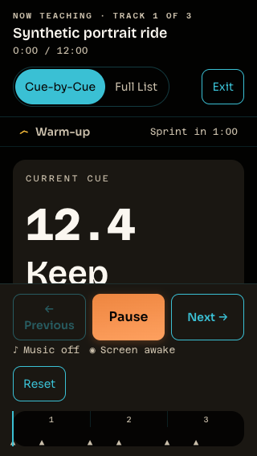
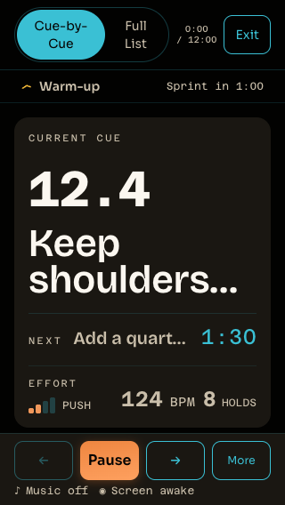

# Live short-viewport teaching clarity — 2026-10-11

Round `r20261011c`, lane 1. Verified source, tests, evidence and handoff are locally
committed and unpublished on `codex/r20261011c-live-short-viewport`, based on
`6691c9d73adaf71bd488f3b1293146c8a9925e85`. Steven approved implementation, local
verification and this local commit after orchestrator review. The untracked lane
brief is excluded. Next action: obtain separate push/PR authority. Push, PR, merge,
deployment and cleanup remain unauthorized.

The current cue remains the hero, with Next queued below it. At short portrait
sizes (height ≤700 CSS px and width ≤639 CSS px), the header uses its existing
compact timecode presentation and preserves class/run metadata for assistive
technology. Reset and the timeline move behind the existing More disclosure.
Primary transport and playback/wake status remain visible. Narrow short-screen
vitals use 8px rather than 24px horizontal gaps to keep BPM and holds from wrapping
behind the dock. Existing ≤480px landscape behavior is preserved.

No teaching typography, color, timing, provider integration, shared styles, API,
schema or configuration changed. 375×812 retains its original layout.

## Fresh baseline and candidate

The final harness reproduced the baseline before implementation and again against
the original `LiveMode.tsx` from base `6691c9d`. It confirmed the retained teaching failures
and additional vitals hidden by the dock. The older live-glance packet is unchanged.

| CSS viewport | Baseline failures out of five | Candidate failures out of five |
| ------------ | ----------------------------- | ------------------------------ |
| 375×812      | 0                             | 0                              |
| 375×635      | 2                             | 0                              |
| 320×568      | 5                             | 0                              |

At 375×635, count-bearing cues hide BPM/effort; section/count/holds additionally
hide Next/countdown/holds. At 320×568, every variant hides some vitals, and the two
count-bearing variants also obscure teaching text or Next/countdown. These are
synthetic CSS viewports, not observed iPhone Safari toolbar dimensions.

The fifteen required portrait cases check current summary, Next summary/countdown,
authored count, BPM, timecode, effort/holds when present, primary transport, visible
control targets ≥44×44 CSS px, zero horizontal overflow, clipping bounds and
multiple hit-test points. Complete arbitrary authored text need not fit in the
summary. Full guidance and Full List retain the complete string.

The five cue variants also run at 812×375 landscape and 1440×900 desktop. These ten
rows gate primary transport/visible controls and horizontal overflow; supporting
content may require scrolling. A separate representative stress-state check at
each of the five viewports verifies that Next/countdown/BPM/holds, Full guidance
and Full List are reachable through scrolling, More exposes a 44px Reset control,
pause works, waiting/error recovery holds teaching position with reachable actions,
and a short synthetic class reaches completion. All **25 viewport rows and 20
state rows pass**. The initial error rows captured transient waiting; visual
review corrected the harness to require the settled alert, Playback stopped,
provider-load failure copy and Retry playback. The final rerun passed all five
error rows, and its landscape error screenshot was inspected. Do not interpret the landscape/desktop row pass as all content
visible simultaneously.





## Evidence method

The fixture renders actual LiveMode, app CSS, generated tokens and self-hosted
fonts, using synthetic instructor-authored payloads. Default fixtures have no
provider references. Recovery fixtures use a Vite-only synthetic SoundCloud
adapter that either remains pending or rejects; it never loads a widget, contacts
a provider, or plays audio. Completion uses a 750ms synthetic track.

The new capture script imports the existing dependency-free CDP driver read-only
and uses isolated installed Chrome. It waits for fonts, expected state and repeated
matching geometry samples; identifies teaching content through labels, text and
region markers; and does not require a particular clamp or CSS class. Pointer
actions hit visible controls; scrolling is introduced only when an action/content
requires it. Disabled transport controls are checked for bounds/clipping, not
claimed to be operable. Enabled controls are hit-tested at interior points to avoid
mistaking rounded transparent corners for occlusion.

`results.json` records outcomes and executed source/test hashes for each capture.
`sha256.json` records final source and artifact hashes. Baseline source is the
original HEAD; source snapshots in the hash records distinguish it from candidate.
Small formatting refinements to evidence scripts occurred between captures.

This evidence is synthetic Chrome layout/interaction verification. It establishes
neither provider/audio acceptance, screen-reader output nor real-device usability.

## Native browser zoom limitation

**Actual 200% native zoom remains unverified.** A dedicated headed Chrome profile
was launched, CDP metric emulation cleared, and its normal 1200×843 CSS viewport
confirmed. CUA app selection bound the active user-profile Chrome window rather
than this isolated process. The orchestrator's separate test-tab attempt also met
concurrent user activity and stopped before issuing a zoom command. Viewport
emulation and CDP page scaling are not counted as native zoom. No user browser
zoom setting was changed.

The existing shell scrollport and focus/recovery logic are preserved, but native
200% reflow/functionality remains an acceptance gap to resolve in a safely targeted
attended session.

## Local verification and restart

- Frozen-lockfile dependency installation succeeded; no lockfile/package changes.
- Focused `pnpm --filter @ritmofit/web exec vitest run src/components/LiveMode.test.tsx`:
  **91/91 passed**. The previous CSS-string assertions were replaced with actual
  long-guidance/Next/announcement behavior assertions; Chrome owns layout checks.
- Full twelve-step CI-equivalent gate: **all pass** on the exact final source/test
  hashes, with browsers paused. Web **1148**, API **486**, music **30**, Worker
  integration **184** tests pass. Build, generated OpenAPI/no-diff, contract parity
  and dependency audit also pass. The [receipt](./full-gate.json) preserves each
  command/output, timings and identical source/test hashes before and after.
- Capture hashes match the successful gate's final product/test hashes. Diagnostic
  corrections are retained in `results.json`, including pre-correction error-PNG
  hashes. Initial error PNG paths were superseded by the corrected captures; their
  original pixels remain in the tool conversation, not this directory.

One mistaken `pnpm ... test -- <file>` invocation started the broader web suite;
it was interrupted when its scope became visible and rerun with the explicit
focused command above. The interrupted run is not a full-gate pass.

Reproduce from this checkout after `pnpm install --frozen-lockfile` and
`pnpm --filter @ritmofit/web tokens`, using an isolated Chrome process with a
dedicated CDP port and profile:

```sh
node docs/audits/live-short-viewport-2026-10-11/serve.mjs
CDP_PORT=9235 CAPTURE_STAGE=candidate node docs/audits/live-short-viewport-2026-10-11/capture.mjs
```

Default fixture port is 5185. Baseline capture uses `CAPTURE_STAGE=baseline`
against the original base `6691c9d` source, and exits 1 for the demonstrated defects. Candidate capture exits 1 for any required
viewport/state failure, incomplete matrix or page exception. Never rerun the old
packet's scripts into its retained evidence directory.
