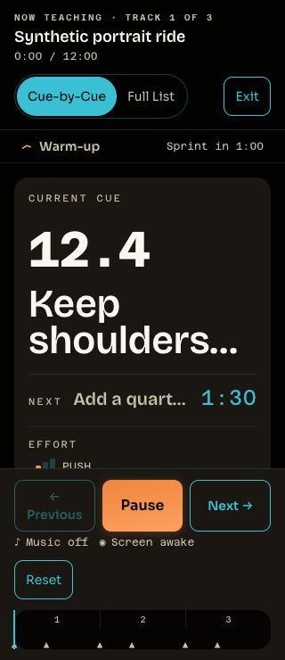
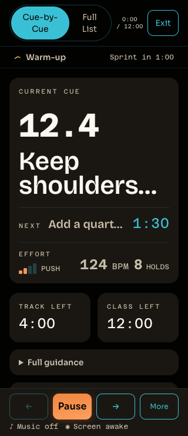
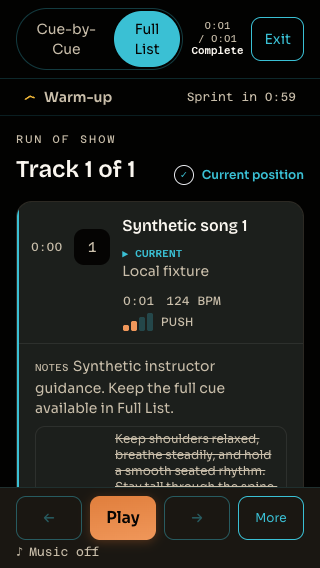

# Live short-viewport clarity: reviewed P2 corrections — 2026-10-11

Round `r20261011c`, Lane 1, [draft PR #518](https://github.com/steven-crosby/ritmofit-web/pull/518).
The published checkpoint is `9702fd0299063f02890a5d82ab990e047763afc7`, based on
`6691c9d73adaf71bd488f3b1293146c8a9925e85`. Steven approved fixing the review findings,
regression checks, local gates, follow-up commit/push, and renewed CI/review. The
orchestrator owns staging, commit, push and CI; merge, deploy and cleanup remain
unauthorized. The planning brief remains excluded.

## Reviewed behavior and correction

The first implementation compacted portrait chrome through 700 CSS px. Review
found a gap immediately above that cutoff and a hidden completion label because
all visible run-state metadata lived in the collapsed header. The initial capture
checked completion DOM presence, which did not prove visual availability.

The correction keeps portrait chrome compact through **800 CSS px** at widths
≤639px. Fresh checks validate 799/800/801px at both 320px and 375px widths. The
existing expanded 375×812 design remains intact. Existing ≤480px landscape
compaction is retained. Current/next cue typography, colors, timing, primary
transport and full guidance remain unchanged.

On completion, the compact clock slot also shows the existing **Complete** state
in primary text. The normal header and existing screen-reader announcement remain
available. Exit and finish-control behavior are unchanged; this is a visible state
correction, not a finish-control redesign.

## Fresh P2 reproduction and candidate

The published `9702fd0` source was tested before product edits. All 90 viewport
rows and 68 state rows completed with no page exception. The intentional baseline
gate failed for four viewport rows:

- 375×701, section/count/holds: vitals behind transport.
- 320×701, count and section/count/holds: vitals behind transport.
- 320×740, section/count/holds: vitals behind transport.

Five completion rows also failed visible bounds/clipping/hit tests: 375×635,
320×568, 812×375, 375×700 and 320×700. The remaining baseline cases passed.

The corrected candidate passes **90/90 viewport rows and 68/68 state rows**.
Eighty portrait rows require current/next summaries, countdown, authored count,
BPM/timecode, meaningful effort/holds, visible 44px controls and zero horizontal
page overflow at the teaching entry position. Landscape/desktop allow appropriate
scrolling and separately check supporting content reachability.

Boundary coverage at both portrait widths is 700/701/740/799/800/801px, plus the
original target viewports and 320×812. State coverage exercises guidance, More,
pause, Full List, waiting/error recovery and completion at 17 viewports. Completion
must be visibly unobscured in **both Cue-by-Cue and Full List**, not merely present
in the DOM. The capture waits for fonts and matching geometry samples and uses
actual Chrome hit testing. No teaching type was shrunk.







## Evidence identities and diagnostics

The original `baseline/`, `candidate/`, `capture.mjs`, `results.json`,
`full-gate.json` and `sha256.json` remain unchanged checkpoints. Their final source
was `9702fd0`; their original completion pass does not prove visible completion.
The original README is retained byte-for-byte in `p2-baseline/README.md`.

New `capture-p2.mjs`, `p2-results.json`, `p2-baseline/`, `p2-candidate/`,
`p2-full-gate.json` and `p2-sha256.json` describe the corrections. The baseline
executed harness is retained byte-for-byte as `p2-baseline/capture.mjs` (a source
snapshot, not a relocated executable). Its hash matches the baseline receipt.
Capture attempts are phase-labeled and retained. An initial baseline attempt
missed a moving preflight control before fonts settled; it produced an incomplete
matrix and was rejected. The corrected baseline completed all rows before edits.

The fixture renders actual LiveMode, app CSS/tokens and self-hosted fonts with
synthetic instructor-authored payloads. Recovery uses a Vite-only pending/rejecting
adapter; no widget, provider contact or audio stream is involved. Completion uses
a 750ms synthetic track. All evidence is synthetic Chrome layout/interaction;
it does not establish provider/audio, actual-device or screen-reader acceptance.

## Local verification and next action

- Focused LiveMode tests: **93/93 pass**, including compact completion in both views.
- Complete CI-equivalent P2 gate: **all twelve effective checks pass**, with
  browsers paused. Web **1150**, API **486**, music **30**, Worker integration **184**
  tests pass. Build, OpenAPI/no-diff, contract parity and dependency audit pass.
  `p2-full-gate.json` retains the initial test-parameter typecheck failure and the
  passing format/typecheck/lint reruns after its explicit string annotation. Final
  renderer/test hashes match the final capture and remain unchanged through the
  completed gate.
- Hosted CI passed on published checkpoint `9702fd0`. CI for the correction
  follow-up head is pending at this record time; no future hosted pass is assumed.
  Root has commit/push authority and will verify renewed CI/review on its resulting
  exact PR head. The next owner action after those checks is separate merge
  approval. Merge, deployment and cleanup remain unauthorized.

Actual native **200% browser zoom remains unverified**. Dedicated headed Chrome
was attempted previously, but native tooling bound the active user profile and a
root test-tab attempt encountered concurrent user activity. No native zoom command
was issued, and viewport emulation is not counted as native zoom. Real-iPhone and
audible/provider obligations stay in the existing acceptance handoff.

Reproduce from repo root with installed dependencies, generated web tokens and an
isolated Chrome/CDP session under a browser lease:

```sh
node docs/audits/live-short-viewport-2026-10-11/serve.mjs
CDP_PORT=9235 CAPTURE_STAGE=p2-candidate node docs/audits/live-short-viewport-2026-10-11/capture-p2.mjs
```

Default fixture port is 5185. `p2-baseline` labels captures of the original
`9702fd0` source; its demonstrated failures are expected. Any required candidate
failure, page exception or incomplete matrix returns exit 1.
