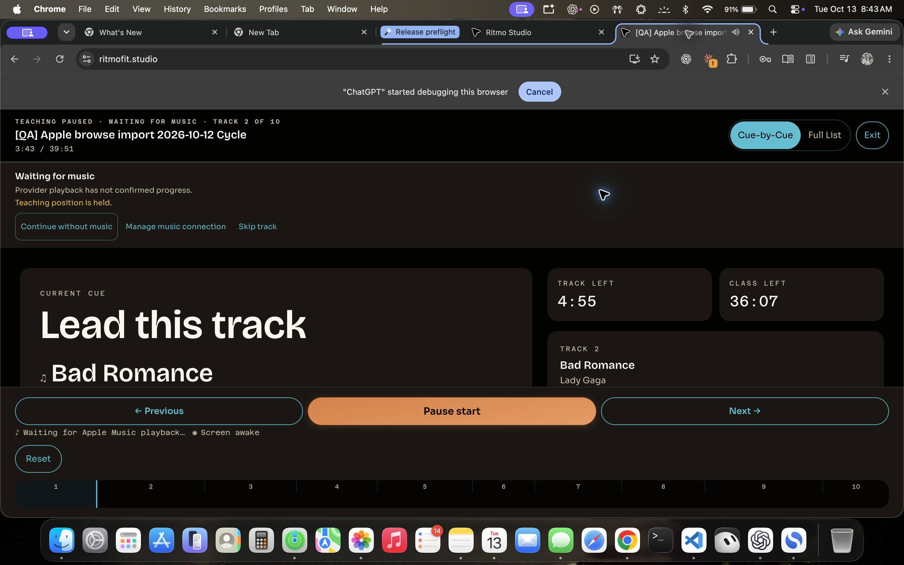

# Attended provider acceptance — 2026-10-13

Deployment: Worker `73493517-2006-4beb-bf7c-cdb1edf298fd`, application source `4fd1ecd`,
SPA `assets/index-C1EvvyLa.js`. Steven supplied human listening reports one step at a time.
SoundCloud's four bounded desktop checks are complete. Apple start, natural handover and post-Exit
silence are confirmed, but a later unwitnessed transport stop remains unresolved. Do not call the
whole Apple run uninterrupted or overall Apple stability accepted.

## Apple Music — bounded observations confirmed; later stop open

Fixture: `[QA] Apple browse import 2026-10-12 Cycle`, ID
`75b7af90-141f-4f56-b02b-0bdd2c1c9dfe`, ten imported tracks.

- Steven confirmed browser authorization and Start enabled, then audible Abracadabra with advancing
  clock and no recovery. Initial agent DOM: Now teaching / track 1, 0:51, Pause available.
- Steven confirmed a clean audible natural handover to Bad Romance. The agent did not seek or press
  Next. No untouched full 40-minute run is required or claimed.
- Steven also saw a momentary notification just before Bad Romance started. His original PNG shows
  Waiting for music / Teaching position held at 3:43, track 2. Later agent DOM shows normal teaching
  track 2 at 4:00 without the panel. Banner duration was not measured. Source maps this panel to
  preparation/buffering/authorization before confirmed provider progress (`LiveMode.tsx`,
  `musicBlocked`, line 732; panel line 949). Presentation is a separate scoped UX follow-up.
- A **later, separate recovery** appeared at 5:18 on track 2: Playback stopped / Music is paused,
  stalled, or its position cannot be verified. Read-only official MusicKit getters returned
  `isPlaying: false`, `currentPlaybackTime: 2`, duration 295, item Bad Romance. Steven reported he
  was not listening when it happened. Cause, audible behavior at that moment and relation to this
  UI release are unestablished. No agent Retry, seek or Next was used to clear it. Preserve this
  as an open investigation, not as proof of a specific code defect or a harmless transition.
- Steven then confirmed Exit returned to Builder and music stopped/stayed silent. His original
  screenshot corroborates Builder return. After Exit, MusicKit reports not playing, time 0 and
  no item ID. This establishes the reported post-Exit result, not uninterrupted preceding playback
  or a reconstructed causal account of the unwitnessed stop.

Original owner PNGs are preserved byte-for-byte. Agent DOM/JPEG/SDK captures are separate.

## SoundCloud — bounded desktop listening checks complete

Fixture: `[QA] SoundCloud transport 2026-10-12 Cycle`, ID
`91c94386-5816-48f5-91aa-61e874abb05b`, one public-widget track St. Pepper Here To Be Alone.
Steven confirmed, separately:

1. Audible start, advancing clock and no recovery.
2. Pause silence and held clock, after being instructed to wait about ten seconds.
3. Audible resume from the paused position, advancing clock and no recovery.
4. Exit returned to the same Builder class, with music stopped and sustained silence.

The agent's initial DOM showed Now teaching at 0:36. After owner Exit, DOM has no iframes and the
selected QA Builder remains on the new SPA. This corroborates widget teardown; it does not replace
the owner's hearing. No account reconnection, library acceptance or natural end/next-track test is
claimed for this one-track public widget check.

## Evidence, follow-up and limits

`human-observations.json` retains exact reports. `acceptance-status.json` keeps confirmed observations
separate from the open later Apple stop. Raw images keep correct PNG/JPEG formats; `sha256.json`
identifies every file. Official SDK transport getters and DOM observations are UI/SDK evidence,
not human hearing. Provider audio was not captured, downloaded, cached, decoded, analyzed, mixed
or proxied. No class content edit, account reconnect or fixture deletion.

Next: an attended, scoped investigation of the later Apple stop, distinguishing external/provider
pause from stale or unverifiable transport progress before assigning a defect or fixing code. Keep
both named fixtures for that follow-up and any separately approved cleanup. Real iPhone,
screen-reader and fresh Pilates playback acceptance remain open. The
[technical deployment packet](../deployment-preflight-518-519-2026-10-13/README.md) remains independent.
