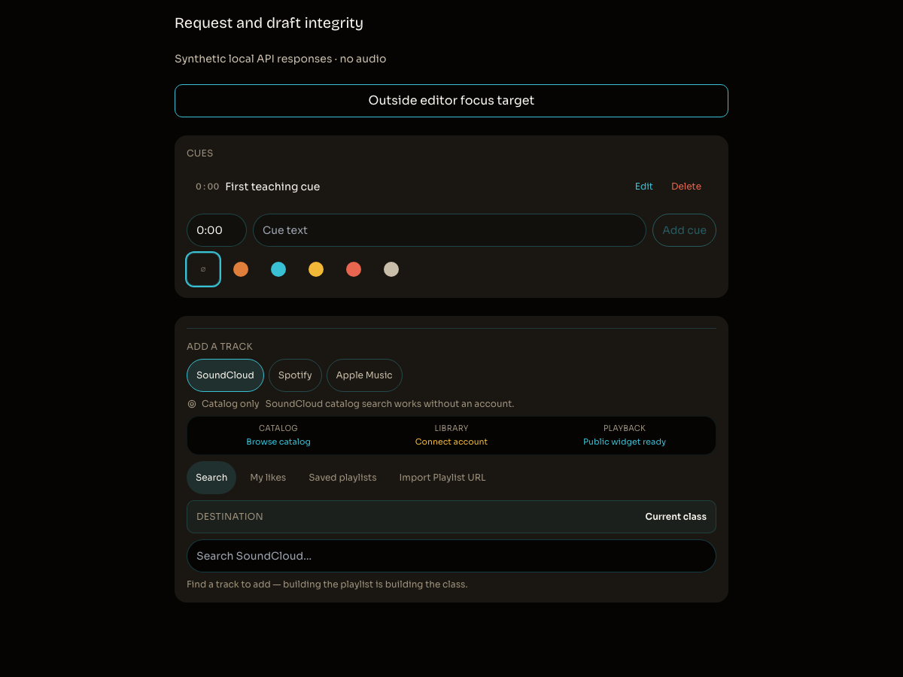
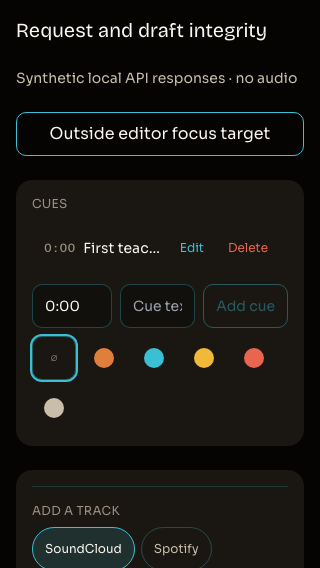

# Two-lane request and draft integrity — integration verification

Author: Codex orchestrator, 2026-10-10. Both lane branches started from `ba92ceaf25a7b470eec23c33766df2658be287fb`; changes are local and uncommitted.

## Source and scope

The external local React fixture imports the actual Lane 1 `ChoreographyEditor.tsx` and Lane 2 `TrackSearch.tsx`, their unchanged API clients, and the existing stylesheet/tokens. It intercepts fetch with synthetic JSON responses and exposes deterministic response delays. No provider SDK audio, production account, credentials, production data, or real music metadata was used.

A baseline URL imports unchanged main components; a candidate URL imports both changed components together. This is component integration, not a combined Git tree, authenticated whole-app test, provider check, or CI result. Source identities are retained in [source-sha256.json](./source-sha256.json).

## Behavioral evidence

[results.json](./results.json) retains three baseline failures and twelve candidate passes:

- Older cue snapshot cannot hide the newer post-save list.
- New cue and move add drafts survive earlier completion.
- New inline cue draft stays open after saving an earlier revision.
- Delayed cue save and move delete honor deliberate outside focus.
- Unchanged cue Save restores the Edit control.
- Replacement playlist URL survives completion with input focus retained.
- URL context round trip suppresses the stale callback while the submitted write finishes.
- Failed URL import retains newer input, focus, and visible error.
- Unmounted cue completion cannot invoke the old parent refresh.
- Unchanged successful URL clears and notifies once.

Native Chrome mouse and keyboard events drove these cases through the repository CDP harness. Its nine-case measurement self-test passed before use. An additional visible Chrome check used the computer-use browser API to hold cue and URL writes simultaneously, enter both newer drafts, and release both responses: both drafts remained, the URL input could retain focus, and page overflow was absent at 1200×787. Interactive delay/release controls belonged only to the external fixture.

## Layout evidence and limitations

Page and panel overflow measurements passed at 1200×900, 390×844, 320×568, 844×390, and 600×304 CSS pixels. Screenshots retain existing components in the synthetic fixture; controls and authored content remain reachable through normal scrolling. Responsive widths used explicit viewport emulation.

Actual native **200% browser zoom is unverified**: Chrome native-app control timed out, and keyboard shortcuts through the tab did not change the measured viewport. The 600×304 check is a compact equivalent viewport only. It must not be presented as actual zoom acceptance.

## Local repository gates

Each frozen lane independently passed all twelve CI-equivalent gate steps; [gate-summary.json](./gate-summary.json) records commands and exits. Lane 1: web 1104, API 486, music 30, integration 184. Lane 2: web 1095, API 486, music 30, integration 184. OpenAPI remained unchanged and contract parity passed. Audit exited 0 with the existing ignored low/moderate advisories.

The round uses existing dependencies through temporary worktree symlinks. `pnpm_config_verify_deps_before_run=false` suppresses automatic freshness installation without changing packages or lockfiles. The initial ordinary gate invocation aborted the implicit install attempt before checks; the subsequent complete run passed with this environment.

## Remaining authority and acceptance

No stage, commit, push, PR, merge, deploy, branch/worktree cleanup, or production mutation occurred. Main and production are unchanged. Commit/push/PR authority is required to deliver the local branches; their combined Git-tree/CI check remains part of the authorized merge train. Actual zoom and real provider/device/listening acceptance remain separate evidence gaps. These fixes introduce no playback, API, schema, migration, token, or iOS contract change.
